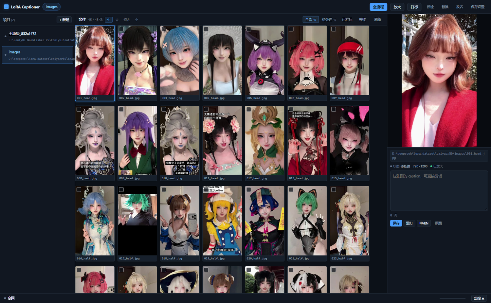
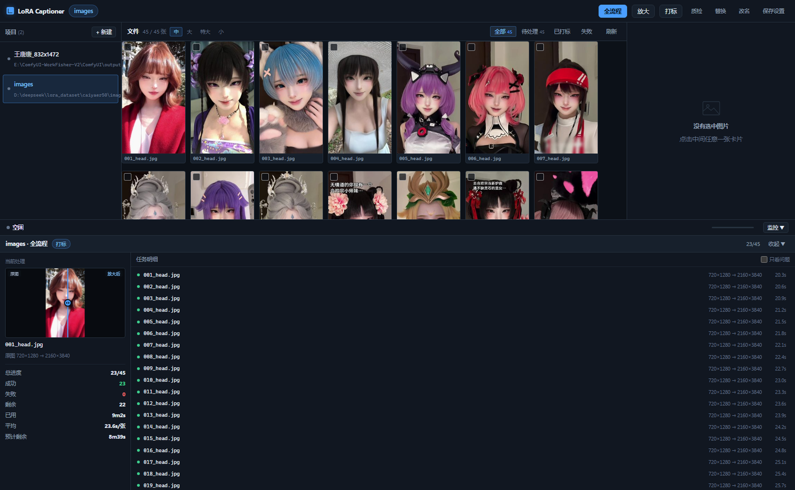
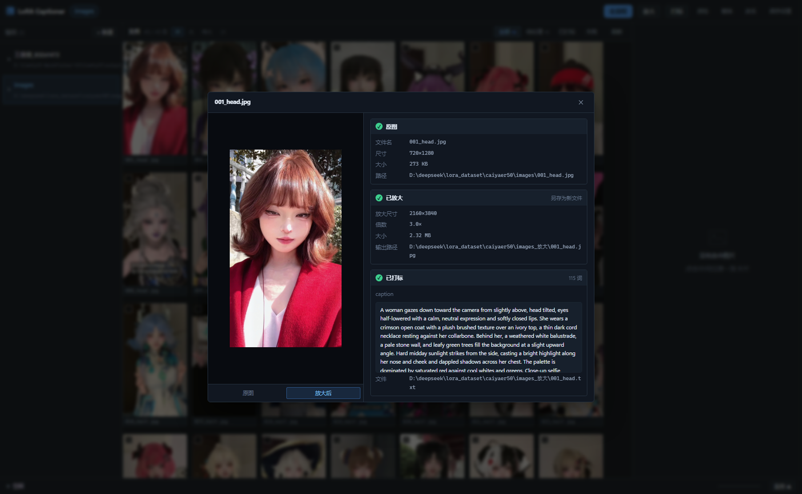

# LoRA Captioner — 训练集打标工作台

LoRA 训练数据集的批量打标与素材放大工具。以「项目」为单位管理数据集，一次性配好目录和参数，之后点一个按钮就能跑完全流程。



## 它解决什么

打标工具不少，但实际用起来总会卡在这几件事上：

- **素材要放大**：原图分辨率不够，得先过一遍超分再打标
- **跑到一半想看看进度**：只有一行百分比，不知道现在处理哪张、还要多久
- **想检查某一张**：得自己去文件夹里翻对应的图和 txt
- **放大效果好不好看不清**：缩小成缩略图后画质差异根本看不出来

这个工具针对这几点做了对应设计。

## 核心概念：项目

一个**项目** = 一个数据集目录 + 一套配置（打标参数、放大倍数、模型等）。

左侧列表点击切换，配置跟着项目走，不用每次重填。项目多了可以**归档**，把做完的收起来。

```
项目 A ─┬─ 源目录 D:\data\yanni
        ├─ 放大输出 D:\data\yanni_放大   （留空则自动推导，也可自定义）
        └─ 配置：模型 / 倍率 / 并发 / 触发词 ...
```

### 项目设置

两种方式打开：鼠标移到项目项上点 `⚙`，或点顶栏的「⚙ 设置」。

弹窗按用途分成四组，所有参数都在这里：

| 分组 | 包含 |
|---|---|
| 基本信息 | 项目名称、数据集目录、放大输出目录 |
| 打标模型 | Provider、模型、思考强度（按模型动态出现） |
| 打标内容 | 打标类型、触发词与位置、人物名、泛化主体、风格提示、附加指令 |
| 放大 | 放大倍数、放大后锐化 |
| 执行行为 | 打标并发、文件夹名、递归子目录、跳过已有 caption、构图联动、自动改名 |

改完点保存即可，配置跟着项目走，切换项目不会互相影响。

## 三种任务

| 任务 | 做什么 | 执行方式 |
|---|---|---|
| **放大** | 源目录 → `源目录_放大`，走 ComfyUI + SeedVR2 | 逐张串行（GPU 一次只能跑一张） |
| **打标** | 生成 caption 写到同名 `.txt` | 内部并发，数量可配（1–8） |
| **全流程** | 先放大，再对放大结果打标 | 两步串行 |

## 单队列执行

所有任务进同一个队列，**同一时刻只跑一个**。

这不是性能取舍，而是修一个真实故障：早期版本里放大、打标、全流程是三套独立的批次状态，彼此看不见对方。结果可以一边跑全流程一边又点放大，两拨任务同时往 ComfyUI 塞请求，显存和内存双份占用，直接把机器拖垮。

现在一个执行器线程消费一个队列，从结构上不可能并发了。

## 实时监控

底部队列条点「监控」展开，或者任务启动时自动展开。



左栏是正在处理的那张图，带**滑动对比**（左边原图、右边放大后，鼠标移动就切换分界）。下面是进度、成功/失败、已用时间、平均每张耗时、**预计剩余**。

右栏是逐张明细：状态、`720×1280 → 2160×3840` 的尺寸变化、耗时。失败的行标红并给出原因，可以勾「只看问题」快速定位。

面板做的是增量更新——只改动状态变化的那一行，几十张也不会闪；会自动跟随当前行，但手动滚动后就停止跟随。

## 点开看单张

监控列表里任意一行都能点开，回答「这张到底放大了没、打标了没」。



四块状态：原图信息、放大结果（含倍数和是另存还是覆盖）、caption 全文与词数、本次任务的状态和耗时。

这里有个容易踩的坑：全流程打标的是**放大目录**里的图，所以 `.txt` 不在源目录旁边。详情接口两处都查，不管你点的是源图还是放大图都能找到对应关系。

## 对比与缩放

右侧预览点一下进全屏，对比区双击直接进全屏对比：


三处对比视图（右侧预览、监控面板、全屏）都支持：

- **左右滑动**对比原图与放大后
- **滚轮缩放** 0.5×–8×，以鼠标位置为中心
- 缩放后**拖动平移**，双击复位

两张对比图同步缩放，而分割线在缩放层之外，所以放大后滑动的手感不受影响。

## 其他功能

- **归档**：项目收进归档区，顶栏按钮切换显示/隐藏
- **勾选处理**：点卡片勾选，按钮变成「放大 N 张」，只处理选中的（可以覆盖重跑）
- **质检**：缺失、过短、过长、触发词丢失、风格词/体型词漏网、重复与高相似簇
- **批量替换**：查找替换 caption，先预览 diff 再落盘，自动 `.bak` 备份
- **目录改名**：按 `人名_张数` 规则重命名数据集目录
- **中英切换**：Bing 翻译后缓存，编辑中文时英文版同步跟随
- **缩略图**：网格用 320px 缩略图并缓存，几十张 4K 原图也不会把浏览器拖死

## 三类打标原则

模板在 `prompt_templates/*.md`，直接编辑保存即生效。

| 类型 | caption 要写 | caption 不写 |
|---|---|---|
| 人物 | 姿态/表情/当次服装/背景/光影/机位 | 五官、固定发型肤色、标志性造型（触发词承载） |
| 服装 | 穿着者/姿态/场景/妆发/鞋袜 | 目标服装的颜色材质剪裁 |
| 风格 | 画面内容/主体/场景/构图/客观光影 | 一切风格词（程序二次黑名单剔除） |
| 身材 | 当次服装+姿态+场景+机位（20–45 词短句） | 一切体型词（hourglass/curvy/长腿等，程序二次剔除） |

## 安装与启动

双击 `run_webui.bat`。首次运行会自动建 venv 并装依赖（`requirements.txt`），端口在文件顶部 `PORT=7860` 处改。

手动启动：

```bat
.venv\Scripts\python.exe -m app.main
```

默认 `http://127.0.0.1:7860`。用环境变量 `CAPTIONER_PORT` 可覆盖端口。

### 停止

双击 `stop_webui.bat`。

它会先确认服务是否在运行，再调用 `/api/shutdown` 让 uvicorn 正常退出，等端口释放后确认结果。如果接口没生效（比如进程卡死），会自动回退到结束占用端口的进程。

**有任务在跑时会先问你**，确认后才强制停止，避免跑到一半被打断：

```
  正在运行  images · 全流程
            23/45
  任务没跑完，强制停止会中断当前进度（已完成的图不受影响）。
  确定要停? [y/N]
```

端口号写在 `stop_webui.ps1` 顶部，和 `run_webui.bat` 里的 `PORT` 保持一致——改端口时两处都要改。

## 模型引擎

两种来源，在项目配置里选：

- **DSH 网关**：OpenAI 兼容接口，带「✓ 可看图」分组的模型才能打标
- **本地 Ollama**：需要视觉模型（如 `ollama pull qwen3-vl:8b`），纯文本模型会返回空

思考强度按网关 `/models` 返回的 `reasoning.efforts` **动态生成下拉选项**——不同模型的可选档位不同，有的没有，所以没有就隐藏该字段。

## 放大的实现

放大不加载模型，而是把任务交给本机 ComfyUI 执行：

1. 图上传到 ComfyUI 的 `input` 目录
2. 提交 API 格式工作流（SeedVR2）
3. 轮询 `/history/{prompt_id}`，完成后 `/view` 取回
4. `/free` 释放显存

早期版本是在 WebUI 进程内直接加载模型，结果 3.2GB 的 UNET 加上中间张量把内存吃到只剩 0.7GB，机器卡死。改成走 ComfyUI 后峰值只有 1.9GB，跑完立刻回落。

需要 ComfyUI 在 `http://127.0.0.1:8188` 运行，模型文件名为 `seedvr2_3b_int8_convrot.safetensors` + `seedvr2_ema_vae_fp16.safetensors`。默认 3× 放大、lanczos 预缩放、adain 色彩修复。

## 目录结构

```
run_webui.bat      启动（双击）
stop_webui.bat     停止（双击，调用 stop_webui.ps1）
app/
  main.py        FastAPI 应用，接口与任务处理器
  executor.py    单队列执行器（Job 记录逐张明细）
  projects.py    项目存储（目录 + 配置 + 归档）
  upscaler.py    ComfyUI 客户端（SeedVR2）
  captioner.py   扫描、caption 组装、质检
  providers.py   网关与 Ollama 调用、Bing 翻译
static/
  index.html     整个前端（原生 JS 单页）
prompt_templates/  三类打标提示词模板
docs/screenshots/  README 用截图
```

技术栈：FastAPI + SSE + 原生 JS。依赖只有 fastapi / uvicorn / pillow / pyyaml / httpx。

## 注意事项

- 放大依赖 ComfyUI，打标依赖网关或 Ollama，两者都没起时会直接给出提示而不是静默失败
- 密钥只从 `~/.dsh/.credentials.yaml` 读取，不落其他位置
- `projects.json`、`queue_state.json`、`.thumb_cache/` 都是运行时数据，已在 `.gitignore` 中排除

## License

见 [LICENSE](LICENSE)。
